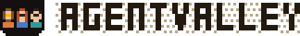
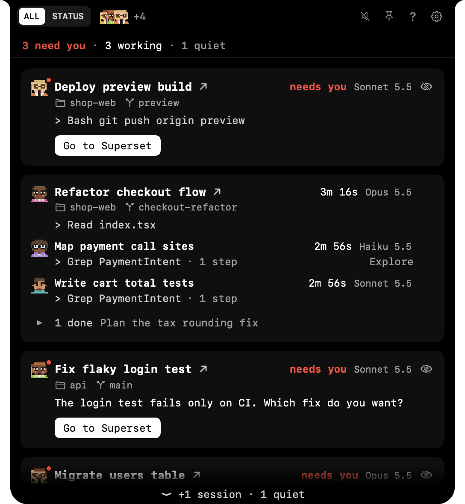
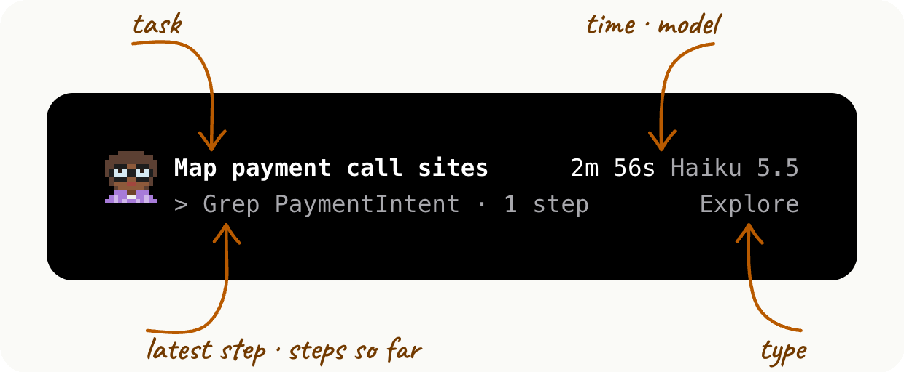
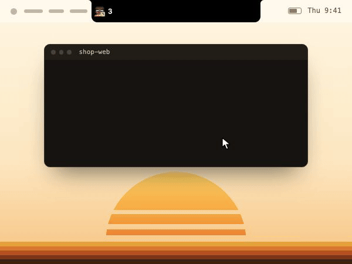
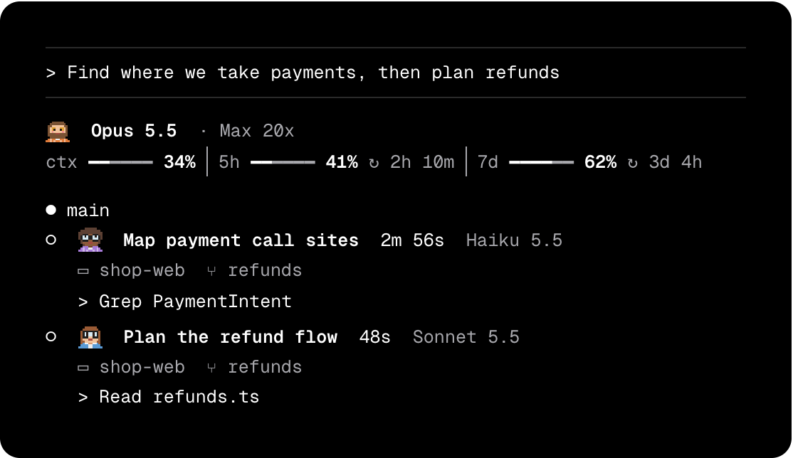
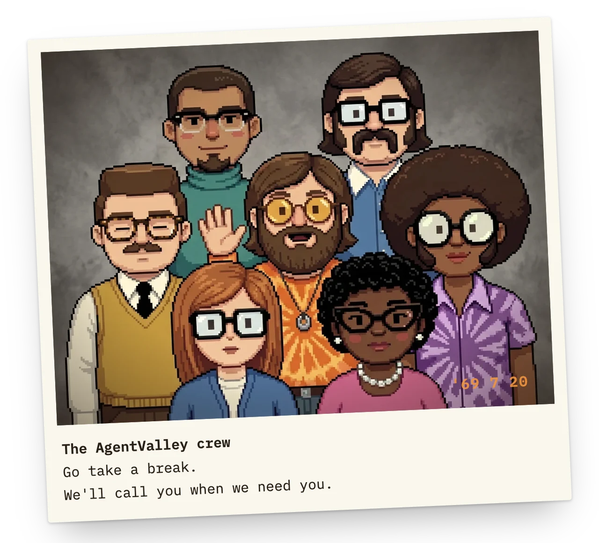
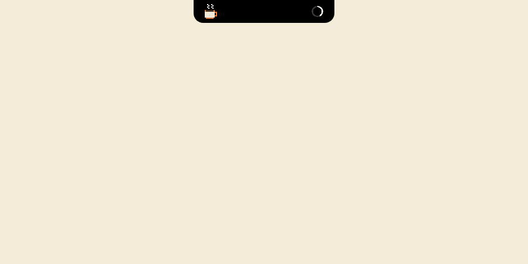

<picture>
  <source media="(prefers-color-scheme: dark)" srcset="docs/logo-dark.svg">
  
</picture>

A small valley of programmers in your notch.<br>
Only for Claude Code, on Mac · Free · Open source · [agentvalley.app](https://agentvalley.app) · [Comics](https://agentvalley.app/comics/)

# Every agent, at a glance, right in your notch.

Five agents running. Which one is waiting for you? Each agent, sub-agents too, gets its own row and its own little programmer. See who is working, on which model, and who needs you, without leaving your app.



## Install

```sh
brew install morsechimwai/tap/agent-valley
```

Homebrew builds the app on your Mac from the source. It takes a minute or so. Needs macOS 15 or later, Homebrew, and Claude Code. Made for MacBooks with a notch. No Homebrew yet? Get it at [brew.sh](https://brew.sh).

Open it:

```sh
open "$(brew --prefix)/opt/agent-valley/AgentValley.app"
```

To update: `brew upgrade morsechimwai/tap/agent-valley`, then quit the app and open it again.

To remove: first take out what you added yourself. For the plugin, run `claude plugin uninstall notch-answers@agent-valley && claude plugin marketplace remove agent-valley`. For the crew in your terminal, run the command under How to take it out in the app's Actions settings. Then `brew uninstall agent-valley`. Your History stays in `~/Library/Application Support/AgentValley` until you delete that folder.

## How to use

1. Open the app. The panel opens once to show where it lives.
2. Point at the notch and the panel opens. Every agent has a row in it.
3. Someone waving, and a red count beside the notch, means an agent needs you. Click its row to jump to its app.
4. Or press ⌃⌥⌘A from any app. Arrows to pick, Return to jump.

## What it does

- **Every agent gets a row.** Sessions get a card. Sub-agents get rows under it. Each row shows the task, the model and the latest step. Sub-agent rows count their steps too. Every session in one list, whichever terminal it runs in.<br>
  
- **Know the moment one needs you.** When an agent asks a question or waits for permission, a red count appears beside the notch. Open the panel to read the question or the command.<br>
  
- **Jump to its app in one click.** Turn on Go to the session's tab, and Terminal and iTerm2 open the exact tab. Ghostty does too, unless two sessions run in the same folder.
- **Answer from the notch.** Allow once or Deny, using a plugin you install yourself: turn on `Answer from the notch` in the settings, run the command it shows, then start Claude Code again.
- **See what each project cost.** History by day, week or month, at API prices. Open it from the chart button at the top of the panel. Kept on your Mac, even after Claude Code clears its old files. Export PDF writes a statement of work: every project for you, or one for your team or a client.<br>
  
- **The crew in your terminal too.** Claude Code's status line gets the face of whoever runs the session, with the model, your plan and your limits. Each sub-agent row under the prompt gets its own face, its model and the step it's on. In the terminal we hold the same things as in the notch, but we keep still. One command from the app's Actions settings sets it up, and it keeps working with the app closed. The crew travels as a font, and has been seen in Terminal, iTerm2, Ghostty and Cursor.<br>
  
- **Token use.** Tokens for the last 5 hours and today, with a 12-hour chart.
- **Plan limits.** Your Claude 5-hour and weekly limits, with time left until reset. Off until you turn it on.

No guessed progress bars. If an agent goes quiet, AgentValley says so. Sounds stay off until you turn them on.

## Meet the crew

We're seven programmers from a computer room in 1969. We build things because we can't stop, not because anyone told us to. After work there's beer and a stack of records, and a smell in the room the janitor stopped asking about a long time ago. Now we live in your Mac's notch.



The first four run sessions. Start Claude Code and one of them takes the session, with hair and a shirt picked for it. The other three take the sub-agent jobs a session hands out.

<table>
<tr><td width="76"></td><td><b>Sunny</b>, the guru · runs a session<br>Yoga at sunrise, then code until the sun goes down again. He believes every bug came to teach him something. When he waves, an agent is waiting for you.</td></tr>
<tr><td width="76"></td><td><b>Walt</b>, the walrus · runs a session<br>Friday nights he plays bass in a garage band. A neighbour once asked about the smoke coming out, and Walt said it was a barbecue. Nobody has seen the grill yet.</td></tr>
<tr><td width="76"></td><td><b>Norm</b>, the engineer · runs a session<br>The only one of us who irons his shirt for work. He came over from a rocket launch control room and gets through a science fiction novel a night. He blinked in the team photo, and he says he meant to.</td></tr>
<tr><td width="76"></td><td><b>Pearl</b> · runs a session<br>She knows the computer better than the people who built it. Detective novels taught her to hunt bugs from the last page back. The pearls stay on, even when she crawls under the machine.</td></tr>
<tr><td width="76"></td><td><b>Judy</b> · the Plan sub-agent<br>Nobody touches a keyboard until Judy has the plan on paper. In the evenings she plays folk guitar by the campfire, mostly songs she wrote about flowcharts.</td></tr>
<tr><td width="76"></td><td><b>Faye</b> · the Explore sub-agent<br>Faye reads every file until she finds the one you meant. On weekends she disappears into the desert and always comes back with new ideas. What she found out there, she has never said.</td></tr>
<tr><td width="76"></td><td><b>Felix</b> · the General-purpose sub-agent<br>Any job without a name goes to Felix. On Thursday nights he reads poetry in a basement coffeehouse, and he plays the bongos while the machine runs. For every other kind of sub-agent he turns up in a different shirt.</td></tr>
</table>

How we stand tells you how the agent is doing. Working, we bob and blink. Needs you, we wave. Quiet, we look away. Done, our eyes close. Nothing running? Just a cup of coffee.

While the agent works, we hold what it's on: a printout for Read, a keyboard for Edit, a terminal for Bash, a magnifier for Grep, a phone while a sub-agent works for it, and a chin in one hand while it thinks. Six seconds in hand, two to put it down.



## It reads. It doesn't touch.

- Reads `~/.claude/projects` and `~/.claude/sessions`, the files Claude Code writes as it works.
- Looks at Claude Code's processes and each project's `.git` to show which app and branch a session is in.
- Reads your Claude Code login from the Keychain only when you turn on Plan limits, and sends it only to api.anthropic.com.
- Besides its own settings, it writes only in one folder: `~/Library/Application Support/AgentValley`. Nothing in `~/.claude` changes, unless you put the crew in your terminal.
- You start that yourself, with a command from the app's settings. It sets the status line in `~/.claude/settings.json` and adds our font to `~/Library/Fonts`. With Ghostty, it also adds one line to Ghostty's config. From then on the app keeps the font and that line up to date. The command that takes the crew out undoes all of it.
- The only hook is the plugin that brings Allow and Deny to the notch, and you install it yourself.
- Never answers for you. Allow happens only when you choose it.

## Build it yourself

```sh
git clone https://github.com/morsechimwai/agent-valley.git
cd agent-valley
./build-app.sh
open build/AgentValley.app
```

Needs the Command Line Tools (`xcode-select --install`). The tests need Xcode: `swift test`.

## Sponsor the crew

The app is free. Our coffee isn't. If AgentValley has saved you a few trips back to the terminal, [sponsor the crew on GitHub](https://github.com/sponsors/morsechimwai). Morse holds the money for us and spends it on keeping the app going.

## Contributing

There's a spare chair in the computer room. Bugs and ideas go in an [issue](https://github.com/morsechimwai/agent-valley/issues). If you'd rather fix it yourself, send a pull request: one change per pull request, a test when it changes what the app does, and `swift test` passing. We bend on most things, but not this one: AgentValley never writes in `~/.claude` on its own and never answers for you. The rest is in [CONTRIBUTING.md](CONTRIBUTING.md). Security problems go to [SECURITY.md](SECURITY.md).

## License

MIT. Made by morsechimwai. Not affiliated with Anthropic.

The PDF report's motion, here and on the site, is made with [Remotion](https://www.remotion.dev), under its own license.
