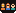

**AgentValley**<br>
A small valley of programmers in your notch.<br>
For Claude Code on Mac · Free · Open source · [agentvalley.app](https://agentvalley.app)

<br clear="left">

# Every agent, at a glance, right in your notch.

Each agent, sub-agents too, gets its own row and its own little programmer. See who is working, on which model, and who needs you, without leaving your app.


## Install

```sh
brew install morsechimwai/tap/agent-valley
```

Homebrew builds the app on your Mac from the source. It takes a minute or so. Needs macOS 15 or later, Homebrew, and Claude Code. Made for MacBooks with a notch.

Open it:

```sh
open "$(brew --prefix)/opt/agent-valley/AgentValley.app"
```

The panel opens once to show where it lives. After that, point at the notch to open it.

To update: `brew upgrade agent-valley`, then quit the app and open it again.

To remove: if you installed the plugin, run `claude plugin uninstall notch-answers@agent-valley && claude plugin marketplace remove agent-valley` first. Then `brew uninstall agent-valley`. Your History stays in `~/Library/Application Support/AgentValley` until you delete that folder.

## What it does

- **Every agent gets a row.** Sessions get a card. Sub-agents get rows under it. Each row shows the task, the model and the latest step. Sub-agent rows count their steps too.
- **Know the moment one needs you.** When an agent asks a question or waits for permission, a red count appears beside the notch. Open the panel to read the question or the command.
- **Jump to its app in one click.** Turn on Go to the session's tab, and Terminal and iTerm2 open the exact tab. Ghostty does too, unless two sessions run in the same folder.
- **Answer from the notch.** Allow once or Deny, using a plugin you install yourself: turn on `Answer from the notch` in the settings, run the command it shows, then start Claude Code again.
- **See what each project cost.** History by day, week or month, at API prices. Kept on your Mac, even after Claude Code clears its old files.
- **Plan limits.** Your Claude 5-hour and weekly limits, with time left until reset. Off until you turn it on.
- **Keyboard.** Press ⌃⌥⌘A from any app. Arrows to pick, Return to jump.

No guessed progress bars. If an agent goes quiet, AgentValley says so. Sounds stay off until you turn them on.

## It reads. It doesn't touch.

- Reads `~/.claude/projects` and `~/.claude/sessions`, the files Claude Code writes as it works.
- Looks at Claude Code's processes and each project's `.git` to show which app and branch a session is in.
- Reads your Claude Code login from the Keychain only when you turn on Plan limits, and sends it only to api.anthropic.com.
- Besides its own settings, it writes only in one folder: `~/Library/Application Support/AgentValley`. Nothing in `~/.claude` changes.
- The only hook is the plugin that brings Allow and Deny to the notch, and you install it yourself.
- Never answers for you. Allow happens only when you choose it.

## Build it yourself

```sh
git clone https://github.com/morsechimwai/agent-valley.git
cd agent-valley
./build-app.sh
open build/AgentValley.app
```

Needs the Command Line Tools (`xcode-select --install`). The tests need Xcode: `swift test`.

## Sponsor the crew

The crew runs on coffee. If AgentValley has saved you a few trips back to the terminal, [sponsor them on GitHub](https://github.com/sponsors/morsechimwai). The money goes to morsechimwai, who spends it on keeping the app going.

## Contributing

Bugs and ideas: open an issue. See [CONTRIBUTING.md](CONTRIBUTING.md). Security problems: see [SECURITY.md](SECURITY.md).

## License

MIT. Made by morsechimwai. Not affiliated with Anthropic.
